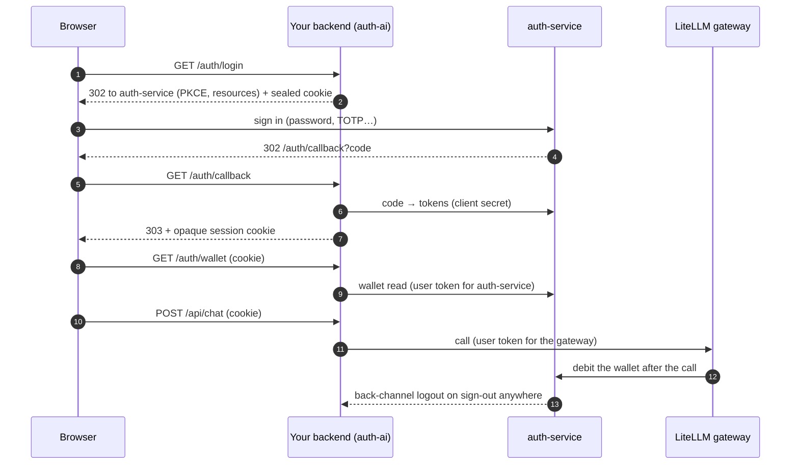

<p align="center">
  <picture>
    <source media="(prefers-color-scheme: dark)" srcset="docs-site/public/logo-dark.svg">
    
  </picture>
</p>

<h1 align="center">CIRCLE auth-ai for Python</h1>

<p align="center">
  <em>The Python SDK for CIRCLE auth-service — sign-in, entitlements, billing and LLM credit, in one library.</em>
</p>

<p align="center">
  <a href="https://github.com/circle-rd/auth-ai-python/actions/workflows/ci.yml"></a>
  <a href="https://pypi.org/project/auth-ai/"></a>
  <a href="https://pypi.org/project/auth-ai/"></a>
  <a href="LICENSE"></a>
  <a href="https://mypy-lang.org"></a>
  <a href="https://github.com/circle-rd/auth-service"></a>
</p>

Let your application sign users in with a self-hosted
[CIRCLE auth-service](https://github.com/circle-rd/auth-service), read what they
are entitled to (roles, permissions, plan features), meter what they consume,
and call LLMs on their behalf through a [LiteLLM](https://docs.litellm.ai)
gateway that bills their credit wallet — without writing any OAuth, token
refresh, logout or billing plumbing yourself.

This is the Python port of [`@circle-rd/auth-ai`](https://github.com/circle-rd/auth-ai):
same behaviours, same wire contract, same error codes. A Python backend can serve
the TypeScript browser client and the React and Vue bindings unchanged.

Full documentation: **https://docs.circle-cyber.com/auth-ai-python/**

```python
handlers = AuthHandlers(auth=auth, grants=grants, sessions=sessions, secret=secret, ai=ai)
install_auth(app, handlers)  # /auth/login, /callback, /me, /logout…


@app.get("/api/models")
async def models(session: Session = Depends(require_auth(handlers))):
    return await ai.for_user(session.user_id).gateway.list_models()
```

## Principles

- **Do not reinvent OAuth.** Protocol work stays with the maintained libraries
  [Authlib](https://authlib.org) and [joserfc](https://jose.authlib.org); the SDK
  adds what is specific to auth-service on top of them.
- **Backend-for-frontend by default.** The browser holds one opaque session
  cookie. Access and refresh tokens never reach it.
- **Fail loud, leak nothing.** Invalid state is rejected, not repaired. Errors
  carry stable codes; HTTP responses expose the code and a generic message, and
  the detail stays in your logs.
- **Strict at every boundary.** Every external payload (tokens, API answers,
  cookies, configuration) is validated with [pydantic](https://docs.pydantic.dev);
  the package ships `py.typed` and is checked with `mypy --strict`.
- **Async all the way.** Built on [httpx](https://www.python-httpx.org) and
  `asyncio`; bring your own `httpx.AsyncClient` for proxies, transports or tracing.
- **Centralized spending.** The SDK never debits a wallet itself: the gateway
  bills each call, so margin and pricing stay under the administrator's control.

## Features

**Sign-in and sessions**

- Authorization-code flow with PKCE, `state` and `nonce`, multi-audience
  tokens ([RFC 8707](https://www.rfc-editor.org/rfc/rfc8707)), TOTP handled by
  the provider.
- One serialized refresh-token chain per user, with per-audience access tokens
  minted on demand and never stored.
- Sealed one-shot login cookie, hashed session ids, `__Host-` cookies,
  same-origin redirect targets, refused cross-site logout.
- Claims (roles, permissions, features, plan, organization) renewed from the
  provider on a schedule.
- **Back-channel logout**: signature, `typ`, audience, event, lifetime and
  replay checks, then the sessions and grant of the user end.

**Entitlements**

- Typed claims and helpers: `has_role`, `has_permission` (write implies read),
  `has_feature`, `get_feature`.
- Bearer-token verification for your own API, with RFC 9728
  protected-resource metadata and `WWW-Authenticate` challenges (MCP-friendly).

**LLM gateway and credit wallet**

- One switch in auth-service ("LiteLLM support") and one option here
  (`gateway_url`) turn on the gateway and wallet audiences.
- An origin-locked `httpx` client that signs OpenAI-compatible calls with a
  fresh user token (hand it to the `openai` package); model, agent and MCP
  server listing; gateway errors mapped (`402` → `GW_001`, `429` with
  `Retry-After`, …).
- Wallet reads: balance, spend statistics, per-session usage, transactions,
  top-up link. Amounts are exact `int` micro-euros.

**Billing and consumption**

- Machine client (`client_credentials`, cached and single-flighted): a user's
  subscription, metered usage and invoices; usage reporting with idempotency
  keys for features billed per call.

**Delivery**

- Framework-agnostic `WebRequest` → `WebResponse` handlers (mount them
  anywhere) and a Starlette / FastAPI adapter.
- Python 3.12+ (tested on 3.12, 3.13 and 3.14), full type declarations, MIT licensed.

## Install

```sh
pip install "auth-ai[fastapi]"   # or auth-ai[starlette], or plain auth-ai
```

Register your application in auth-service first: a confidential application with
the **LiteLLM support** switch on (if you call the gateway), the redirect URI
`https://<host>/auth/callback` and the back-channel logout URI
`https://<host>/auth/backchannel-logout`.

## Quick start

A FastAPI backend (the stores below live in memory: demo only, see
[Production](#production)):

```python
import os
from collections.abc import AsyncIterator
from contextlib import asynccontextmanager

from fastapi import Depends, FastAPI

from auth_ai import AiClient, AuthClient, GrantManager, MemoryGrantStore
from auth_ai.starlette import install_auth, require_auth
from auth_ai.web import AuthHandlers, MemorySessionStore, Session

auth = AuthClient(
    {
        "issuer": "https://auth.example.com",
        "client_id": "my-app",
        "client_secret": os.environ["AUTH_CLIENT_SECRET"],
        "redirect_uri": "https://app.example.com/auth/callback",
        "gateway_url": "https://llm.example.com",
    }
)
grants = GrantManager(auth=auth, store=MemoryGrantStore())
ai = AiClient(auth=auth, grants=grants)
handlers = AuthHandlers(
    auth=auth,
    grants=grants,
    ai=ai,  # adds /auth/wallet, /auth/wallet/stats and /auth/models for your frontend
    sessions=MemorySessionStore(),
    secret=os.environ["COOKIE_SECRET"],  # 32+ random characters
)


@asynccontextmanager
async def lifespan(_app: FastAPI) -> AsyncIterator[None]:
    yield
    await auth.aclose()


app = FastAPI(lifespan=lifespan)
install_auth(app, handlers)


@app.get("/api/models")
async def models(session: Session = Depends(require_auth(handlers))):
    return await ai.for_user(session.user_id).gateway.list_models()
```

Calling the gateway with the `openai` package (or any OpenAI-compatible SDK that
takes an `httpx` client):

```python
from openai import AsyncOpenAI

gateway = ai.for_user(user_id).gateway
async with gateway.create_http_client() as http_client:
    client = AsyncOpenAI(
        base_url=gateway.openai_base_url,
        api_key="unused",  # replaced by a fresh user token on every request
        http_client=http_client,
    )
    answer = await client.chat.completions.create(
        model="my-model", messages=[{"role": "user", "content": "Hello"}]
    )
```

Reporting usage for a feature billed per call, from your backend:

```python
from auth_ai.server import MachineApi

machine = MachineApi(auth)
await machine.consumption.report(user_id, "audits", 1, idempotency_key="audit-42")
```

A complete, deployable application lives in [`examples/minimal`](examples/minimal).

## Modules

| Import                | What it gives you                                                                       |
| --------------------- | --------------------------------------------------------------------------------------- |
| `auth_ai`             | OIDC client, grants, claims helpers, wallet and gateway clients, error registry         |
| `auth_ai.server`      | Bearer verification, back-channel logout, protected-resource metadata, machine API      |
| `auth_ai.web`         | Sign-in handlers (`WebRequest` → `WebResponse`), session store contract                 |
| `auth_ai.starlette`   | `install_auth`, `require_auth` and `load_session` for Starlette and FastAPI (`starlette` ≥ 0.46) |

## Architecture



```
auth-ai-python/
├── 📁 src/auth_ai/
│   ├── client.py          AuthClient — discovery, PKCE login, refresh, logout, revoke, introspect
│   ├── config.py          Validated configuration (gateway_url adds the gateway audiences)
│   ├── grants.py          GrantManager — serialized refresh rotation, per-audience tokens
│   ├── claims.py          Claim models and entitlement helpers
│   ├── wallet.py          WalletClient and wallet models (int micro-euros)
│   ├── gateway.py         GatewayClient — origin-locked httpx client, listings, MCP URLs
│   ├── ai.py              AiClient.for_user(grant_id)
│   ├── errors.py          AuthAiError + ERR registry (OIDC_*, TOK_*, GW_*, SES_*…)
│   ├── 📁 server/         Bearer verification, back-channel logout, machine API
│   ├── 📁 web/            Sign-in handlers, sealed cookies, session store contract
│   └── starlette.py       Starlette / FastAPI adapter
├── 📁 tests/              pytest suite on a scripted identity provider (no network)
├── 📁 examples/minimal/   Deployable end-to-end app with a self-test
└── 📁 docs-site/          Docus documentation (built into a container image)
```

## Production

The SDK is storage-agnostic on purpose. Before going live:

- **Persist sessions and grants.** Implement `SessionStore` and `GrantStore` on
  your database. The in-memory stores sign everyone out on restart and cannot
  be shared by replicas.
- **Several replicas?** Provide a distributed `GrantLock` (a refresh token
  rotates on every use; a replayed one revokes the whole family) and a shared
  `ReplayStore` for back-channel logout tokens.
- **Secrets from the environment only:** the client secret and a 32+ character
  cookie secret. Neither is ever logged or returned.
- **Registered URIs must match:** `redirect_uri` is `<origin><base_path>/callback`
  and the back-channel URI is `<origin><base_path>/backchannel-logout`, reachable
  over HTTPS by auth-service.
- **Log with `on_error`, answer with `to_public_json()`.** Never forward
  `error.message` or `error.details` to a browser.
- **Keep your ASGI stack current:** keep `starlette` / `fastapi` on a release
  that carries the latest security fixes.

## Documentation

The full documentation is published at
[docs.circle-cyber.com/auth-ai-python](https://docs.circle-cyber.com/auth-ai-python/):
concepts, one guide per framework, the configuration and API reference, the
error-code registry and a production checklist.

**For AI agents** — the documentation is exposed through a built-in MCP server
(HTTP), so agents can query it directly:

| Environment | MCP endpoint                                                           |
| ----------- | ---------------------------------------------------------------------- |
| Production  | `https://docs.circle-cyber.com/auth-ai-python/mcp`                     |
| Local dev   | `http://localhost:3000/mcp` (run `npm run dev` in `docs-site/`)        |

**Contributing** — the development rules in [AGENTS.md](AGENTS.md) (naming,
typing strictness, error handling, testing, security) and the process in
[CONTRIBUTING.md](CONTRIBUTING.md) are mandatory for any contribution.
Security reports: see [SECURITY.md](SECURITY.md). Releases are tracked in
[CHANGELOG.md](CHANGELOG.md).

## Roadmap

- **More adapters** (Django, Flask, Litestar) on top of the framework-agnostic
  handlers, as needs appear.
- **A synchronous facade**, if a real need shows up.

## Credits & license

Built and maintained by [CIRCLE](https://circle-cyber.com). Stands on the
shoulders of [Authlib](https://authlib.org), [joserfc](https://jose.authlib.org),
[httpx](https://www.python-httpx.org), [pydantic](https://docs.pydantic.dev) and
[Starlette](https://www.starlette.io).

Licensed under the **MIT License** — see [LICENSE](LICENSE).
